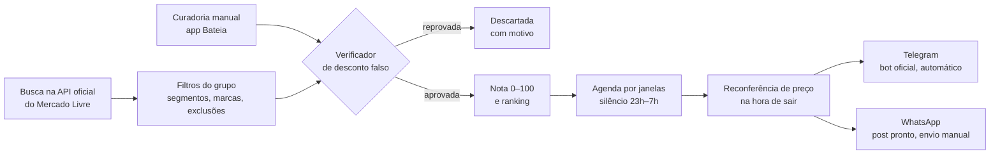

# 🔎 Garimpei Ofertas BR — estudo de caso

**"Desconto falso aqui não!"** Comunidade de ofertas no WhatsApp e no Telegram que só publica promoção com **desconto conferido**. A receita vem de comissão de afiliado do Mercado Livre. Projeto próprio, construído sozinho com o Claude como time de agentes.

> Este repositório é o **estudo de caso**. O código do motor fica em repositório privado.
> Site: [garimpeiofertasbr.com.br](https://garimpeiofertasbr.com.br)

---

## 🎯 O problema

Em data de promoção, muita oferta é maquiada: o preço "de" sobe na véspera, o "desconto" compara Pix com cartão, o kit sai mais caro que os itens separados. Os grupos de ofertas repassam tudo sem conferir, e quem compra perde dinheiro e confiança.

**Hipótese:** uma comunidade que **só publica oferta verificada** ganha confiança e converte mais por post do que um grupo de volume.

## 💡 A solução: um motor que confere antes de publicar

O motor é um app em **Python** que roda localmente. Ele faz o trabalho até a porta do WhatsApp: busca, confere, dá nota, agenda e monta o post.

| Etapa | O que faz |
|---|---|
| **Busca** | API oficial do Mercado Livre (OAuth), com termos e categorias por grupo em YAML |
| **Verificador** | Compara o preço com o **histórico no mesmo meio de pagamento**, barra repetição em 7 dias e duplicatas |
| **Nota (0–100)** | Desconto real (40) + avaliação (20) + vendas (20) + aderência ao grupo (20). A nota só sugere; quem aprova é o humano |
| **Agenda** | Janelas de pico, limite diário por fase, horário de silêncio para tudo |
| **Reconferência** | O preço é conferido de novo antes do envio. Se subiu, o post muda ou sai da fila |
| **Envio** | Telegram automático (API oficial de bots). WhatsApp: o app entrega foto e legenda prontas e o post é enviado à mão |
| **Kill switch** | `/pausar` no bot para tudo na hora |

## 🧠 Decisões de engenharia

| Decisão | Por quê |
|---|---|
| **O LLM nunca vê preço nem link** | O modelo escreve só a abertura e o contexto; preço, desconto e link vêm do código. Assim a IA não tem como errar um número |
| **Trava de texto** | Copy com número, "corre", "últimas unidades", CAIXA ALTA ou abertura repetida é barrada e refeita |
| **O motor não gasta IA** | Busca, filtros, ranking, agenda e texto rodam em código. Tokens só onde agregam (ler o print de um produto escolhido à mão) |
| **Desconto só no mesmo meio de pagamento** | Nunca dizer que "baixou" comparando Pix com cartão |
| **Validar antes de escalar** | Piloto manual com **gate** (cliques ≠ 0, venda pelo link, grupo não esvazia) antes de automatizar o WhatsApp |
| **Automação do WhatsApp pronta, mas desligada** | O envio automático existe e está desligado de propósito. Integrações não oficiais violam os termos do WhatsApp e podem gerar banimento; só liga depois do gate, com ritmo controlado |
| **n8n → Python** | Comecei no n8n e migrei para Python versionado no git, com testes, quando a lógica de verificação cresceu |
| **Escala por degraus** | 1 → 10 → 30 → 100 grupos, cada degrau só depois de 7 dias sem queda |

## 🤖 Como opero com IA

O projeto é tocado por uma pessoa e um **time de agentes Claude**, cada um com um papel e uma régua de qualidade:

- **Curador**, **Copywriter**, **Verificador**, **Métricas/Gate** e **Guardião de infra**, definidos como skills.
- **Padrão de verificação** com critérios de aceitação por tipo de entrega (oferta, copy, métricas, automação, vídeo e site). "Não verificado" nunca conta como aprovado.
- **Memória do projeto:** registro de aprendizados e passagem de turno a cada sessão. Um erro que se repete duas vezes vira regra.
- **Revisão independente** antes de qualquer entrega pública.
- **Humano no controle:** gastar dinheiro, mexer no WhatsApp ou em credenciais sempre passa pela minha aprovação.

## 📢 Conteúdo e aquisição

- **TikTok e Instagram:** cerca de 35 vídeos educativos produzidos ("o 'de' que nunca existiu", "subiu antes da Black", checklist de 5 itens), renderizados com Remotion e agendados no Metricool.
- **Site** com o funil para a comunidade.
- **Zero tráfego pago** no piloto.

## 📊 Números até aqui (honestos)

| Indicador | Valor | Data |
|---|---|---|
| Ofertas buscadas pelo motor em um dia | 139 | 29/10/2026 |
| Aprovadas / rejeitadas pelo verificador / pendentes | 15 / 67 / 57 | 29/10/2026 |
| Posts automáticos no Telegram em um dia | 28 | 06/11/2026 |
| Seguidores no TikTok | 315 | 26/10/2026 |
| Testes automatizados do motor | ~300 | 08/11/2026 |
| Cliques e vendas do piloto | **ainda sem dados suficientes** | — |

O verificador rejeitou quase metade das ofertas de um dia, o que mostra o tamanho do problema que o projeto ataca. O gate de conversão ainda não tem dados para ser julgado, e por isso foi remarcado. Os resultados vão entrar aqui quando existirem.

## 🚀 Próximos passos

- [ ] Fechar o gate com dados reais de clique e venda
- [ ] Link rastreável por grupo, para medir clique por canal
- [ ] Ligar o WhatsApp automático no degrau 1 (10 posts/dia), se o gate passar
- [ ] Segunda fonte de afiliados com API oficial

## 📚 Aprendizados

- Começar pela pergunta de negócio (**clique vira venda?**) antes da tecnologia.
- Deixar números e decisões no código e usar IA só onde ela agrega.
- Um painel com "sem dados" é mais útil do que um número estimado.
- Saber a hora de não ligar uma automação também é uma decisão de engenharia.

---

**Autor:** Felipe Kimura · [LinkedIn](https://linkedin.com/in/felipe-kimura)
